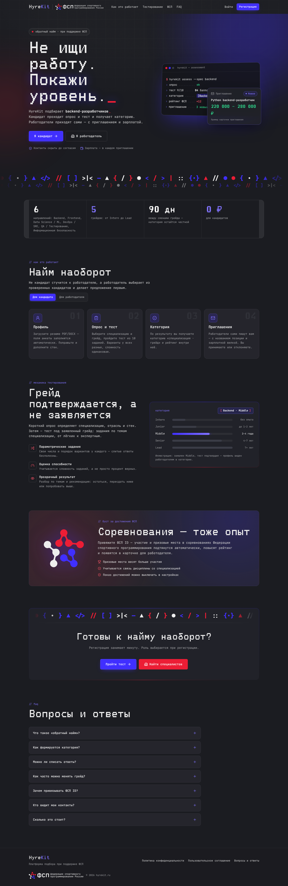
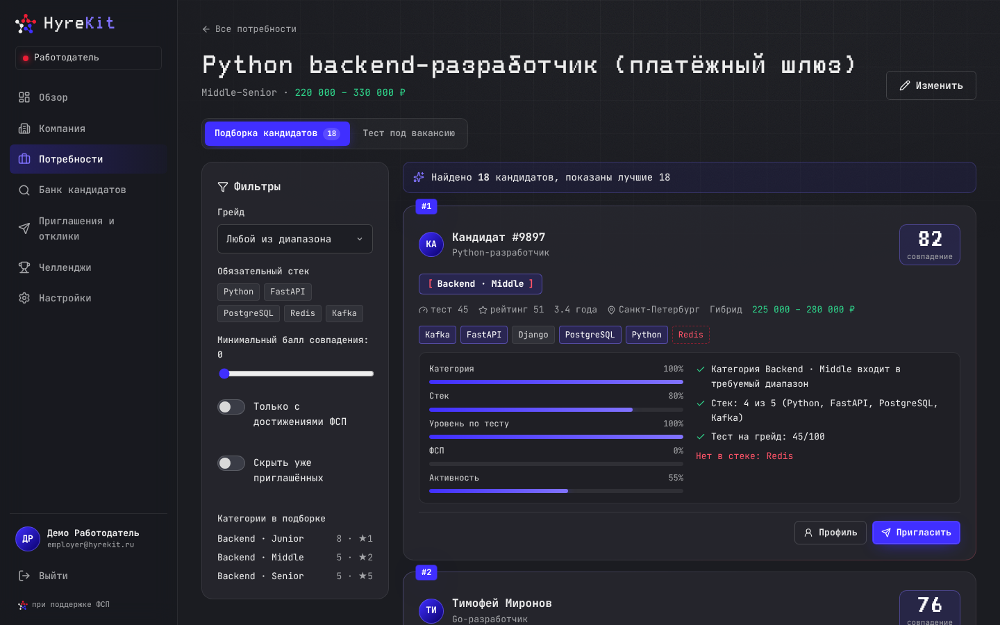
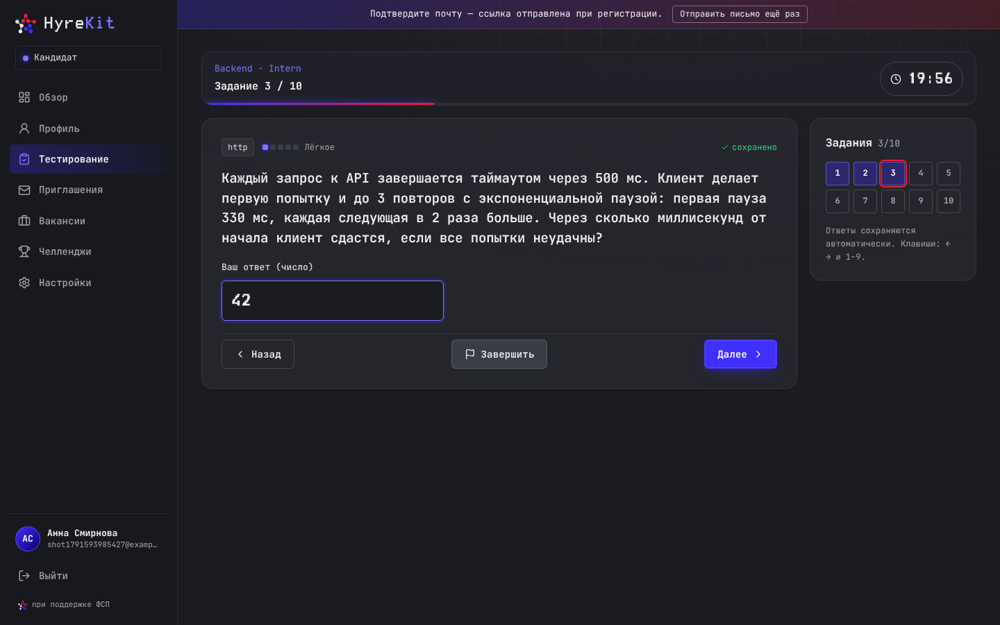
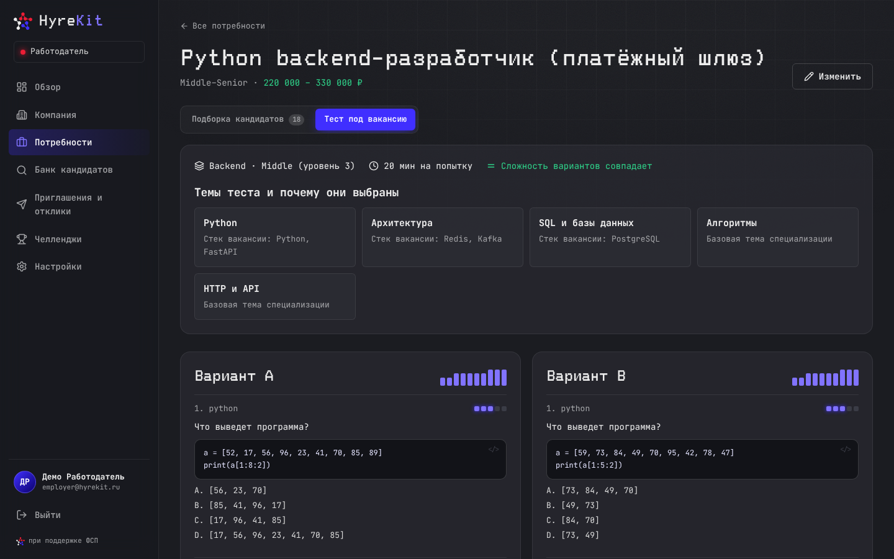
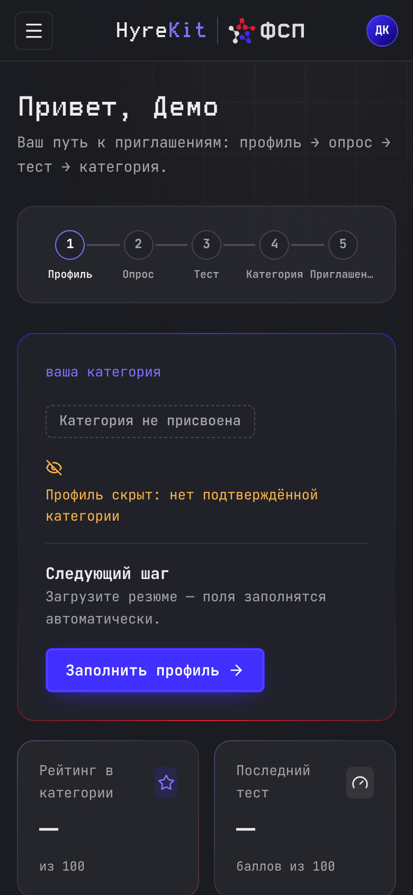
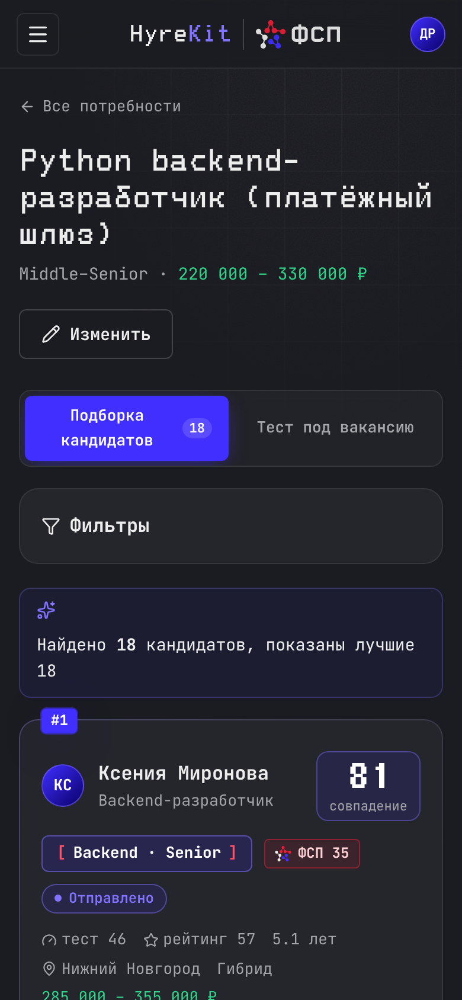
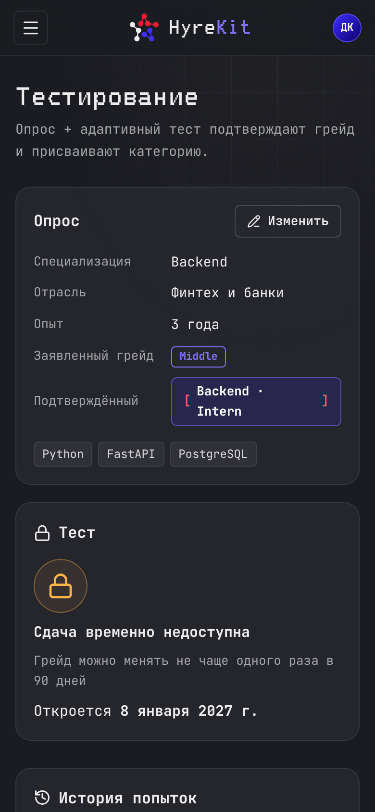
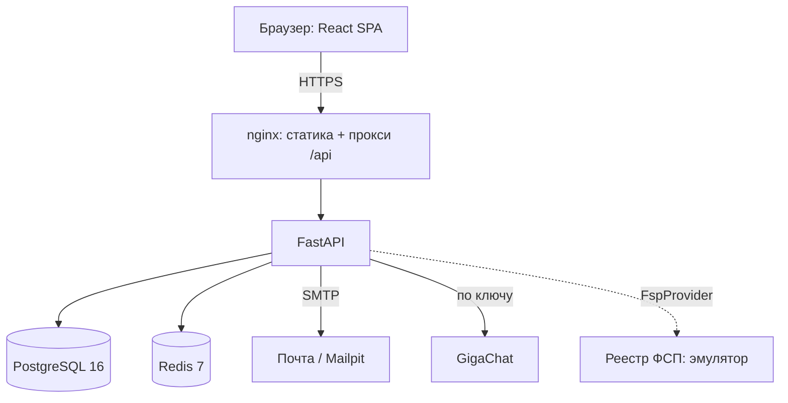

#  HyreKit

## Ссылки

| Что | Адрес |
| --- | --- |
| Прототип | <https://hyrekit.ru> — площадка в Yandex Cloud готовится к выкатке; до неё прототип поднимается локально одной командой ([Инструкция запуска](#инструкция-запуска)) |
| Описание API (Swagger) | <https://hyrekit.ru/docs>, локально — <http://localhost:8000/docs> |
| Репозиторий | <https://github.com/Fighter90/hyrekit_fsp> |
| Сопроводительная документация | [docs/guide/README.md](docs/guide/README.md) |

Платформа-агрегатор ИТ-вакансий с верифицированным профилем достижений участника ФСП. Хакатон Федерации спортивного программирования 2026, команда «Команда 1».

Кандидат проходит тест на грейд и получает категорию «направление · грейд», к профилю подтягиваются достижения из реестра ФСП. Работодатель описывает потребность и получает подборку проверенных кандидатов с объяснимым баллом соответствия, смотрит тест под вакансию и приглашает с вилкой зарплаты. Контакты кандидата открываются только после его согласия.

> **Состояние по `main` 0.1.0 (10.10.2026) — версия к сдаче.**
>
> Работает без ключей и внешних сервисов:
>
> - оба кабинета и лендинг в фирменном стиле ФСП, адаптив от 360 px, анимации с учётом «уменьшить движение»;
> - тест на грейд: 10 параметрических заданий из 36 семейств по 14 темам, оценка по модели Раша, категория или предложение пересдать уровнем ниже, пересдача через 90 дней;
> - подборка под потребность с разбивкой балла, фильтры, банк кандидатов, тест под вакансию с двумя вариантами равной сложности;
> - приглашения, отклики, раскрытие контактов, короткие задания;
> - достижения ФСП из эмулятора реестра, рейтинг внутри категории;
> - демо-аккаунты и синтетический банк из 120 кандидатов, подтверждение почты через Mailpit.
>
> С ключом GigaChat: разбор PDF-резюме и оценка ответов на короткие задания моделью; без ключа — правила.
>
> Не входит в MVP: вход через ФСП ID (Keycloak) и реальный реестр ФСП, модерация работодателей, интеграция с ATS — схемы в [docs/guide/04-arhitektura.md](docs/guide/04-arhitektura.md).
>
> История версий — [CHANGELOG.md](CHANGELOG.md).

## Содержание

- [Ссылки](#ссылки)
- [Инструкция запуска](#инструкция-запуска)
- [Команда и трек](#команда-и-трек)
- [Что это за продукт](#что-это-за-продукт)
- [Визуальная система](#визуальная-система)
- [Состояние проекта](#состояние-проекта)
- [Кабинеты](#кабинеты)
- [Быстрый старт для пользователя](#быстрый-старт-для-пользователя)
- [Быстрый старт для разработчика](#быстрый-старт-для-разработчика)
- [Переменные окружения](#переменные-окружения)
- [Команды](#команды)
- [Архитектура](#архитектура)
- [Структура репозитория](#структура-репозитория)
- [Как ведётся разработка](#как-ведётся-разработка)
- [Тестирование и качество](#тестирование-и-качество)
- [CI](#ci)
- [Безопасность](#безопасность)
- [Развёртывание](#развёртывание)
- [Документация](#документация)
- [Архитектурные решения](#архитектурные-решения)
- [Известные ограничения](#известные-ограничения)
- [Частые проблемы](#частые-проблемы)
- [О хакатоне](#о-хакатоне)

## Инструкция запуска

Нужно: Docker 24+ с Compose v2 и 2 ГБ свободной памяти. Ключи не нужны.

```bash
git clone https://github.com/Fighter90/hyrekit_fsp.git
cd hyrekit_fsp
cp .env.example .env
docker compose up -d --build
```

| Что | Адрес |
| --- | --- |
| Приложение | <http://localhost:3000> |
| Swagger UI | <http://localhost:8000/docs> |
| Письма подтверждения (Mailpit) | <http://localhost:8025> |

Проверка «получилось»: `curl -s http://localhost:8000/health` отвечает `{"status":"ok",...}`, `docker compose ps` показывает app, db, redis, mailpit и frontend в состоянии healthy или running.

При первом старте API применяет миграцию и создаёт демо-данные. Демо-аккаунты, пароль у всех `HyreKit2026`:

| Роль | Почта | Что внутри |
| --- | --- | --- |
| Кандидат | `candidate@hyrekit.ru` | Пустой профиль — путь проходится с нуля |
| Работодатель | `employer@hyrekit.ru` | Компания «ТехноПлатформа», 3 вакансии с подборками, 2 коротких задания |
| Синтетические кандидаты | `talent01@demo.hyrekit.ru` … `talent120@demo.hyrekit.ru` | Прошли тест через симуляцию по модели валидации |

Запуск без Docker и PostgreSQL (SQLite) — в [Быстром старте для разработчика](#быстрый-старт-для-разработчика). Демо-сценарий за 5 минут — [docs/guide/05-zapusk-i-demo.md](docs/guide/05-zapusk-i-demo.md#демо-за-5-минут).

## Команда и трек

| Параметр | Значение |
| --- | --- |
| Команда | Команда 1 |
| Трек | «Цифровая платформа-агрегатор ИТ-вакансий с верифицированным профилем достижений участника ФСП» |
| Хакатон | Хакатон Федерации спортивного программирования, 2026 |

| Участник | Роль |
| --- | --- |
| Яков Дятлов ([@iakov_is](https://t.me/iakov_is)) | product manager |
| Ирина Живова ([@IrinaZhivova](https://t.me/IrinaZhivova)) | product manager |
| Сергей Емельянов ([@sergey_in_job](https://t.me/sergey_in_job)) | backend developer |
| Алиса Живова ([@AlisaZhivova](https://t.me/AlisaZhivova)) | аналитик |

## Что это за продукт

### Аудитория и проблема

Работодатель тратит часы на резюме, где грейд заявлен, но не подтверждён, а сильные олимпиадники и участники соревнований ФСП теряются среди шаблонных откликов. Кандидат не может показать, что его Middle — действительно Middle.

### Обратная механика найма

Не кандидат ищет вакансию, а работодатель находит кандидата:

1. Кандидат заполняет профиль (или загружает PDF-резюме), проходит опрос и тест на предполагаемый грейд.
2. Тест подтверждает категорию «направление · грейд» или предлагает пересдать уровнем ниже. Грейд никогда не понижается тестом.
3. ФСП ID подтягивает достижения: соревнование, уровень, место, год, роль. Профильные дисциплины весят вдвое.
4. Работодатель описывает потребность — и получает подборку по убыванию соответствия с разбивкой: категория 30 %, стек 30 %, тест 25 %, ФСП 10 %, свежесть 5 %.
5. Приглашение с вилкой зарплаты → кандидат принимает → контакты открываются.

### Почему тест нельзя выучить

Задания не хранятся списком: 23 из 36 семейств генерируют условие из случайных данных и вычисляют ответ, поэтому утёкшие ответы к новой попытке почти не подходят. По валидации на синтетических кандидатах Junior со шпаргалкой из 200 чужих попыток сдаёт Middle в 43,1 % случаев против 27,9 % честно — и в 100 % при статичном тесте. Все цифры — [docs/validation/results.md](docs/validation/results.md), методика — [docs/guide/03-metodika-ocenki.md](docs/guide/03-metodika-ocenki.md).

### Границы MVP

Реестр ФСП эмулируется детерминированно по ФСП ID (ID на 0 — участник без истории); замена на реальный API — одна реализация интерфейса `FspProvider`. GigaChat не генерирует и не проверяет задания теста: сопоставимость сложности важнее.

## Визуальная система

Интерфейс в фирменном стиле ФСП: графитовая основа, синий `#402FFF` и красный `#EC1D35`, шрифты JetBrains Mono и TDAText. Токены и правила — [DESIGN.md](DESIGN.md).

| Лендинг | Подборка работодателя |
| --- | --- |
|  |  |
| **Тест на грейд** | **Тест под вакансию** |
|  |  |

| Телефон: кабинет кандидата | Телефон: подборка | Телефон: тестирование |
| --- | --- | --- |
|  |  |  |

Движение: блоки проявляются по очереди, карточки подсвечиваются за курсором, у главных кнопок бегущая рамка, у заголовка лендинга короткий глитч, таймер теста пульсирует в последнюю минуту. Настройка «уменьшить движение» всё это выключает. Все 18 скриншотов — [docs/assets/screens/](docs/assets/screens/).

## Состояние проекта

Задачи ведутся в Linear, проект «HyreKit — платформа подбора ИТ-специалистов (ФСП)», ключи FSP-N. Что в `main`:

| Блок | Задачи | Что сделано |
| --- | --- | --- |
| Профиль кандидата | FSP-22…FSP-25 | Профиль, разбор PDF-резюме, приватность и согласие, PDF-профиль |
| Достижения ФСП | FSP-26 | Эмулятор реестра, балл ФСП, отметка «профильное» |
| Тестирование | FSP-27…FSP-30 | Опрос, банк семейств, план попытки, оценка θ, решение по грейду, пересдача |
| Подбор | FSP-43…FSP-45 | Подборка с объяснением, фильтры, банк кандидатов, тест под вакансию |
| Найм | FSP-46, FSP-50, FSP-51 | Приглашения, вакансии и отклики, короткие задания |
| Демо-данные | FSP-17 | Демо-аккаунты, 120 синтетических кандидатов |
| Валидация | FSP-54, FSP-55 | `scripts/validate.py`, отчёт в `docs/validation/results.md` |

Спецификации каждого блока — [docs/specs/](docs/specs/README.md), журнал — [docs/progress.md](docs/progress.md).

## Кабинеты

| Кабинет | Экраны |
| --- | --- |
| Кандидат | Главная, Профиль, Тестирование, Вакансии, Приглашения, Челленджи, Настройки |
| Работодатель | Главная, Компания, Потребности (подборка и тест под вакансию), Банк кандидатов, Приглашения и отклики, Челленджи, Настройки |

Регистрация с выбором роли, подтверждение почты по ссылке. Кабинеты разделены по ролям на уровне API.

## Быстрый старт для пользователя

1. Открыть приложение и войти как `candidate@hyrekit.ru` / `HyreKit2026`.
2. «Тестирование» → опрос → 10 заданий с таймером → результат с разбором по темам.
3. «Настройки» → согласие на публикацию и ФСП ID, например `FSP-123457`.
4. В другом окне войти как `employer@hyrekit.ru` → «Потребности» → «Python backend-разработчик» → подборка → «Пригласить».
5. Кандидатом принять приглашение — у работодателя откроются контакты.

## Быстрый старт для разработчика

Нужно: Python 3.11+, Node.js 20+.

```bash
python -m venv .venv && source .venv/bin/activate
pip install -r requirements-dev.txt
PATH=$PWD/.venv/bin:$PATH scripts/dev.sh     # API на :8000, база — файл .dev.db (SQLite)

cd frontend && npm ci && npm run dev          # http://localhost:5173, /api проксируется на :8000
```

Только PostgreSQL и Redis в Docker, код локально: `docker compose -f docker-compose.infra.yml up -d`.

## Переменные окружения

Образец — [.env.example](.env.example).

| Переменная | По умолчанию | Назначение |
| --- | --- | --- |
| `SECRET_KEY` | — (обязательна) | Подпись JWT; в production слабый ключ останавливает запуск |
| `DATABASE_URL` | PostgreSQL на localhost | `postgresql+asyncpg://…` или `sqlite+aiosqlite:///…` |
| `REDIS_URL` | `redis://localhost:6379/0` | Лимиты запросов |
| `ENVIRONMENT` | `development` | `production` включает строгие проверки |
| `CORS_ORIGINS` | localhost | Разрешённые адреса фронтенда |
| `GIGACHAT_CREDENTIALS` | пусто | Ключ GigaChat; без него работают правила |
| `SEED_DEMO` | `true` | Демо-аккаунты и синтетический банк при старте |
| `PUBLIC_URL` | `http://localhost:3000` | Адрес фронтенда в ссылках писем |
| `DOCS_ENABLED` | `true` | Swagger UI и `/openapi.json` |
| `SMTP_HOST`, `SMTP_PORT`, `SMTP_USER`, `SMTP_PASSWORD`, `SMTP_TLS`, `MAIL_FROM` | пусто | Почта; пустой `SMTP_HOST` — ссылка подтверждения пишется в лог |

## Команды

```bash
ruff check src tests scripts && ruff format --check src tests scripts   # линтер и формат
pytest --cov=app                                                         # тесты бэкенда с покрытием
PYTHONPATH=src python scripts/validate.py                                # валидация методики
cd frontend && npm run lint && npm run build && npm test                 # фронтенд
docker compose logs -f app                                               # логи API
```

## Архитектура

Монолит FastAPI с модулями по предметным блокам и SPA на React за nginx.



| Слой | Технология |
| --- | --- |
| Фронтенд | React 19, TypeScript, Vite 6, vitest |
| API | FastAPI, Pydantic v2, async SQLAlchemy 2, Alembic |
| Данные | PostgreSQL 16 (в разработке SQLite), Redis 7 |
| LLM | GigaChat |

Методика (`assessment.bank`, `assessment.engine`, `matching.service`) — чистые функции без базы: их проверяют и юнит-тесты, и скрипт валидации. Подробно — [docs/guide/04-arhitektura.md](docs/guide/04-arhitektura.md), модель данных — [docs/schema.md](docs/schema.md), контракт API — [docs/spec/api.md](docs/spec/api.md).

## Структура репозитория

```text
.
├── src/app/
│   ├── assessment/     # банк семейств, план попытки, оценка θ, тест под вакансию, симуляция
│   ├── matching/       # подборка, рейтинг, балл соответствия
│   ├── candidates/     # профиль, резюме, PDF-профиль, приватность
│   ├── employers/      # компания, вакансии, банк кандидатов
│   ├── hiring/         # приглашения и отклики
│   ├── challenges/     # короткие задания
│   ├── fsp/            # интерфейс реестра ФСП и эмулятор
│   ├── auth/ catalog/ llm/ ml/ core/
│   └── main.py
├── frontend/           # React SPA: лендинг, кабинеты кандидата и работодателя
├── tests/              # pytest: сквозной сценарий, методика, ядро
├── scripts/            # dev.sh, validate.py
├── alembic/            # миграции
├── deploy/yc/          # площадка Yandex Cloud: compose, Caddy
├── docs/
│   ├── guide/          # сопроводительная документация 1–7
│   ├── specs/          # спецификации задач FSP-N
│   ├── decisions/      # ADR
│   ├── spec/api.md     # контракт API
│   ├── validation/     # результаты валидации методики
│   └── assets/         # логотип, скриншоты
├── PRODUCT.md CONTEXT.md DESIGN.md AGENTS.md CHANGELOG.md
└── docker-compose.yml
```

## Как ведётся разработка

### Источник истины

Задачи — Linear, ключи FSP-N. Спецификация до кода — `docs/specs/`, контракт API — `docs/spec/api.md`, решения — `docs/decisions/`.

### Путь одной задачи (Spec-Driven Development)

1. Задача в Linear с правилами, числами и ссылками на пункты ТЗ.
2. Спецификация по [шаблону](docs/specs/_template.md): сценарии, правила, критерии приёмки в формате EARS, план тестов.
3. Контракт API до кода — фронтенд и бэкенд пишутся параллельно.
4. Код и тест на каждый критерий приёмки.
5. Запись в [docs/progress.md](docs/progress.md).

Подробно — [docs/process.md](docs/process.md).

## Тестирование и качество

| Что | Как |
| --- | --- |
| Бэкенд | pytest, 183 теста, покрытие 81 % при пороге 70 % |
| Сквозной сценарий | `tests/test_flow.py`: регистрация → опрос → тест → категория → подборка → приглашение → контакты |
| Методика | `tests/test_method/`: каждое семейство на всех уровнях, монотонность θ, правила грейда, подбор, ФСП |
| Фронтенд | vitest, 21 тест; ESLint; сборка TypeScript |
| Валидация | `scripts/validate.py`: равная сложность, утечка, повторяемость, дискриминативность, точность грейда, precision@10 и nDCG@10 против базовых способов |

Ключевые результаты валидации:

| Показатель | Значение |
| --- | --- |
| Профилей сложности на грейд | 1 (варианты равной сложности) |
| Junior сдаёт Middle: честно / со шпаргалкой / статичный тест | 27,9 % / 43,1 % / 100 % |
| Грейд по тесту: точно / в пределах шага | 70,5 % / 99,5 % (заявленный — 63,0 %) |
| Повторное прохождение: корреляция θ | 0,69 |
| Precision@10 подборки, backend / devops | 0,87 / 0,96 против 0,80 / 0,85 по заявленному грейду |

## CI

GitHub Actions ([.github/workflows/ci.yml](.github/workflows/ci.yml)) на каждый push и PR:

- бэкенд: `ruff check`, `ruff format --check`, pytest с порогом покрытия, `scripts/validate.py`;
- фронтенд: `npm ci`, lint, сборка, тесты.

## Безопасность

- Пароли — bcrypt; JWT access 30 минут, refresh 30 дней; секрет только из окружения.
- Лимиты: регистрация 3 в минуту, вход 5 в минуту с адреса (Redis).
- Роли проверяются на каждом методе; кандидат видит только своё, работодатель — только свою компанию.
- 152-ФЗ: согласие на публикацию с датой, псевдоним до раскрытия имени, контакты только после принятия приглашения или отклика.
- `.env` в git не попадает, `.gitleaks.toml` — проверка секретов.

## Развёртывание

Целевая площадка — <https://hyrekit.ru>: ВМ Compute Cloud в Yandex Cloud, Docker Compose из `deploy/yc/`, Caddy с сертификатом Let's Encrypt. Пошагово — [deploy/yc/README.md](deploy/yc/README.md) и [docs/runbook.md](docs/runbook.md).

## Документация

| Документ | Что внутри |
| --- | --- |
| [docs/guide/](docs/guide/README.md) | Сопроводительная документация для жюри: продукт, сценарий, методика, архитектура, запуск, технологии, команда |
| [docs/specs/](docs/specs/README.md) | Спецификации задач |
| [docs/spec/api.md](docs/spec/api.md) | Контракт API |
| [docs/schema.md](docs/schema.md) | Модель данных |
| [docs/validation/results.md](docs/validation/results.md) | Результаты валидации |
| [docs/runbook.md](docs/runbook.md) | Эксплуатация |
| [docs/process.md](docs/process.md), [docs/progress.md](docs/progress.md) | Процесс и журнал |
| [PRODUCT.md](PRODUCT.md), [CONTEXT.md](CONTEXT.md), [DESIGN.md](DESIGN.md) | Продукт, словарь, визуальная система |

## Архитектурные решения

| ADR | Решение |
| --- | --- |
| [0001](docs/decisions/0001-stek.md) | Стек: FastAPI, PostgreSQL, React |
| [0002](docs/decisions/0002-gigachat.md) | GigaChat как LLM, правила без ключа |
| [0003](docs/decisions/0003-parametricheskie-zadaniya-i-rasch.md) | Параметрические задания и модель Раша |
| [0004](docs/decisions/0004-podbor-obyasnimyi-ball.md) | Подбор по объяснимому баллу |
| [0005](docs/decisions/0005-fsp-provider.md) | Интерфейс реестра ФСП и эмулятор |
| [0006](docs/decisions/0006-sqlite-dlya-razrabotki.md) | SQLite для разработки |
| [0007](docs/decisions/0007-fsp-brand.md) | Фирменный стиль ФСП |

## Известные ограничения

- Реестр ФСП эмулируется: API и формат данных в хакатоне не предоставлены.
- Методика проверена на синтетических кандидатах; калибровка сложности на живых данных — после запуска.
- Концептуальные задания раскрываются быстрее генеративных, поэтому в попытке их не больше одного.
- Модерации работодателей и интеграции с ATS нет — только концепция.

## Частые проблемы

| Симптом | Что сделать |
| --- | --- |
| Порт 8000, 3000 или 5432 занят | Остановить локальный сервис или поменять порт в `docker-compose.yml` |
| Письмо подтверждения не пришло | Открыть Mailpit <http://localhost:8025>; без Docker ссылка в логе API |
| `SECRET_KEY` не задан | `cp .env.example .env` и задать значение |
| Подборка пустая | Демо-данные создаются при `SEED_DEMO=true`; перезапустить API |

## О хакатоне

Хакатон Федерации спортивного программирования 2026. Трек — «Цифровая платформа-агрегатор ИТ-вакансий с верифицированным профилем достижений участника ФСП». Команда — «Команда 1». Лицензия — [GPL-3.0](LICENSE), сторонние компоненты — [THIRD_PARTY_NOTICES.md](THIRD_PARTY_NOTICES.md).
