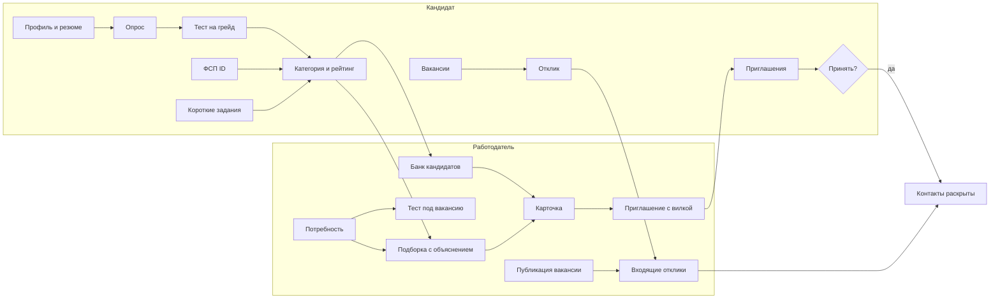
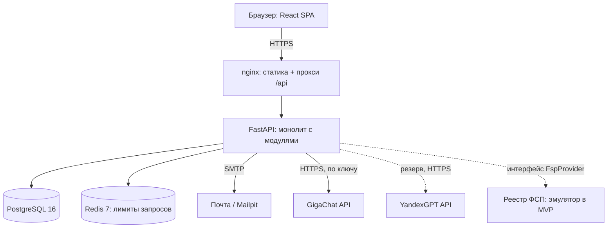
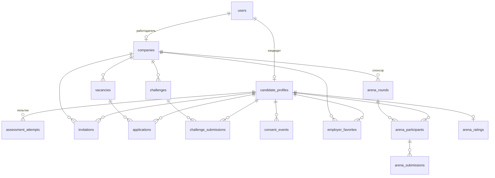
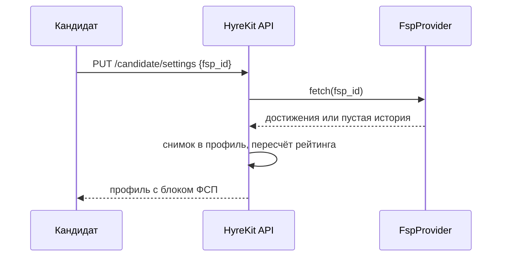
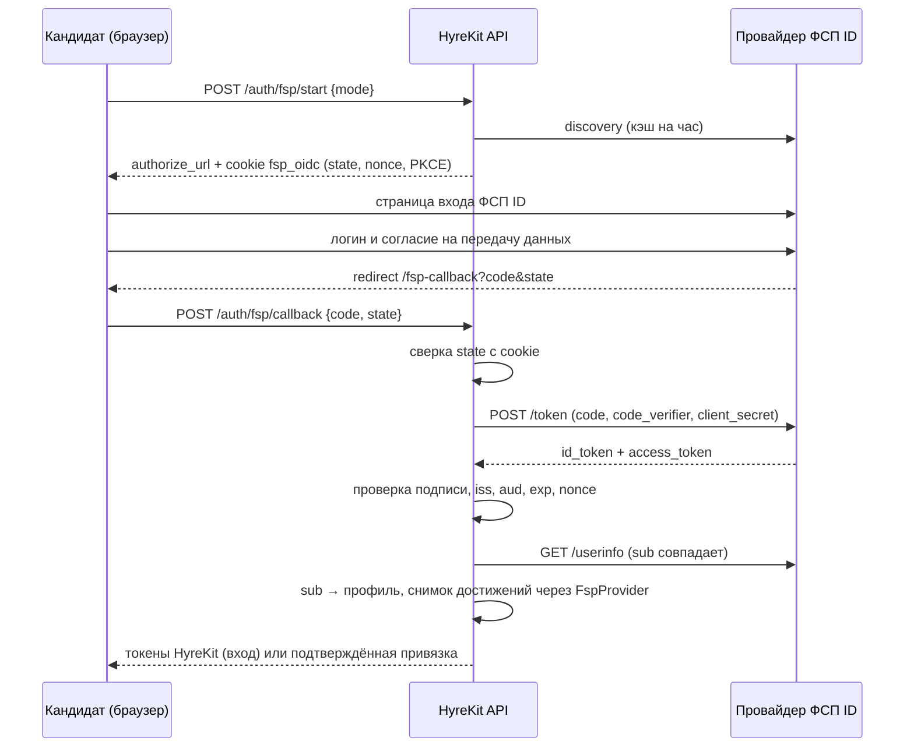

# 4. Архитектура

## Функциональная архитектура

| Функциональный блок | Модуль бэкенда | Экраны |
| -- | -- | -- |
| Регистрация, вход, роли, подтверждение почты | `auth`, `core.mailer`, `core.roles` | `/auth`, `/verify/:token` |
| Справочник специализаций, грейдов, тем | `catalog` | опрос, фильтры |
| Профиль кандидата, разбор резюме, PDF-профиль, приватность | `candidates`, `ml.parser`, `llm` | профиль, настройки |
| Тестирование: банк, план, оценка, решение | `assessment` | тестирование |
| Достижения ФСП | `fsp` | настройки, карточка кандидата |
| Подбор и поиск | `matching` | подборка, банк кандидатов |
| Компании и вакансии | `employers` | компания, потребности |
| Приглашения и отклики | `hiring` | приглашения, вакансии |
| Короткие задания | `challenges` | челленджи в обоих кабинетах |

## Компонентная архитектура

Монолит с явным разделением слоёв и слабо связанными модулями — вариант, прямо допущенный ТЗ 3.5. Каждый модуль бэкенда содержит `models.py` (SQLAlchemy), `service.py` (бизнес-логика без HTTP) и `router.py` (FastAPI). Модули общаются через сервисные функции, а не через роутеры. Методика (`assessment.bank`, `assessment.engine`, `matching.service`) — чистые функции без доступа к базе, поэтому их проверяет и скрипт валидации, и юнит-тесты.

| Компонент | Технология | Роль |
| -- | -- | -- |
| Фронтенд | React 19, TypeScript, Vite | Оба кабинета и лендинг, ленивые маршруты по ролям |
| API | FastAPI, Pydantic v2, async SQLAlchemy | Бизнес-логика, OpenAPI |
| Хранилище | PostgreSQL 16 (в разработке — SQLite) | Пользователи, профили, попытки, вакансии, приглашения |
| Кэш и лимиты | Redis 7 | Ограничение частоты входа и регистрации |
| LLM | GigaChat, резерв YandexGPT (`app.llm.chain`) | Разбор резюме, оценка ответов на короткие задания, разбор решений Arena. Если не ответил ни один провайдер, работают правила; состояние — `GET /llm/status` |
| Песочница Arena | Landlock, seccomp, rlimit, аудит-хук Python | Запуск чужого кода на Python и Node.js внутри контейнера приложения без привилегий: без сети, без новых процессов, файловая система только для чтения |
| Почта | SMTP; Mailpit в docker-compose | Подтверждение адреса |

### Модель данных

Подробно по полям — [docs/schema.md](../schema.md). Схема создаётся миграцией `alembic/versions/0001_initial_schema.py`, журнал согласий и избранное добавляет `0002_consents_favorites.py`, таблицы Code Arena — `0005_code_arena.py`.

## Описание API

Все методы описаны спецификацией OpenAPI, которую генерирует FastAPI: Swagger UI — `/docs`, ReDoc — `/redoc`, JSON — `/openapi.json`, копия в репозитории — [docs/openapi.json](../openapi.json) (у каждого метода есть summary, схемы запросов и ответов). Контракт для фронтенда с типами и кодами ошибок — [docs/spec/api.md](../spec/api.md).

| Группа | Префикс | Основные методы |
| -- | -- | -- |
| Авторизация | `/api/v1/auth` | `register`, `login`, `refresh`, `verify/{token}`, `resend-verification`, `me` |
| Справочник | `/api/v1/catalog` | `GET` — специализации, грейды, отрасли, форматы работы |
| Кандидат | `/api/v1/candidate` | профиль, резюме, PDF, настройки, ФСП, опрос, тест, приглашения, вакансии, отклики, задания |
| Работодатель | `/api/v1/employer` | компания, вакансии, подборка, тест под вакансию, банк кандидатов, категории, приглашения, отклики, задания |
| Code Arena | `/api/v1/arena` | раунды, вход, запуск на примерах, отправка, таблица и поток SSE, разбор задач, рейтинг, витрина и раунды работодателя |
| Служебное | `/health` | проверка живости |

Ошибки возвращаются единым форматом `{error_code, message, detail}`; коды: 400 — валидация, 401 — нет токена, 403 — чужая роль или ресурс, 404 — нет объекта, 409 — конфликт состояния, 422 — ошибка схемы, 429 — превышен лимит.

## Безопасность и 152-ФЗ

| Требование ТЗ 3.5 | Реализация |
| -- | -- |
| Согласие на обработку и публикацию | Флаг согласия с датой; без него профиль не попадает к работодателям. Текст согласия — страница `/privacy` |
| Разграничение прав по ролям | Зависимости `require_candidate` и `require_employer`; кандидат видит только свои записи, работодатель — только свою компанию |
| Защита контактов | Контакты и скрытое ФИО раскрываются только после принятия приглашения или отклика |
| Хранение паролей и токенов | bcrypt; JWT access 30 минут и refresh 30 дней; секрет только из окружения, слабый секрет в production останавливает запуск |
| Защита от перебора | Лимиты: регистрация 3 в минуту, вход 5 в минуту с адреса |
| Минимизация | Работодатель видит псевдоним «Кандидат #A1B2», пока кандидат не открыл имя в настройках приватности |
| Исполнение чужого кода | Решения Arena запускаются отдельными процессами под Landlock и seccomp без сети и записи на диск, с лимитами процессора и памяти; JavaScript включается только при обоих слоях ядра. Состояние слоёв на стенде — `GET /api/v1/arena/sandbox` |

## Интеграция с реестром ФСП

API и структура данных ФСП в хакатоне не предоставлены (ТЗ 4), поэтому интеграция спроектирована через интерфейс и эмулятор.

### Что берём из реестра

| Поле | Зачем работодателю |
| -- | -- |
| Соревнование и его уровень (всероссийский, межрегиональный, региональный) | Масштаб конкуренции |
| Дисциплина (продуктовое, алгоритмическое программирование, ИБ, робототехника, беспилотные системы) | Связь с профилем вакансии |
| Место | Сила результата |
| Год | Актуальность |
| Роль в команде (капитан, участник) | Лидерский опыт |

Балл ФСП 0–100 складывается из уровня соревнования, места и давности, а дисциплина, профильная для специализации кандидата, весит вдвое больше (`fsp.provider.summarize`). Работодатель видит список достижений с отметкой «профильное» и итоговый балл. Кандидат без истории получает `has_history: false`: блок показывает «Достижений ФСП пока нет», рейтинг считается по тесту и свежести.

### Как устроено в MVP

`MockFspProvider` детерминирован по ФСП ID формата `FSP-NNNN…`: один и тот же ID всегда даёт одну историю, а ID, оканчивающийся на 0, моделирует участника без истории. Ответ сохраняется снимком в профиле, поэтому подборка не зависит от доступности реестра.

### Вход и привязка через ФСП ID (OpenID Connect)

Ручной ввод ФСП ID не доказывает, что идентификатор принадлежит кандидату. Поэтому HyreKit — клиент OpenID Connect: кандидат входит у провайдера ФСП ID, и только после этого ФСП ID получает отметку «подтверждён ФСП ID». Поток — Authorization Code + PKCE (S256), код обменивает бэкенд как конфиденциальный клиент.

Состояние потока (`state`, `nonce`, `code_verifier`) хранится в подписанной HttpOnly-cookie на 10 минут, поэтому вход работает на любом числе экземпляров API. Один участник ФСП (`sub` провайдера) подтверждается не более чем в одном профиле; вход ищет профиль по `sub`, затем кандидата с подтверждённой провайдером почтой, иначе создаёт нового подтверждённого кандидата. HyreKit выпускает свои JWT, поэтому кабинеты и роли не меняются.

Провайдер задаётся переменными `FSP_OIDC_*`. Keycloak ФСП в рамках хакатона недоступен, поэтому приложение поднимает встроенный тестовый провайдер по тому же протоколу (`/api/v1/fsp-id`: discovery, страница входа, token, userinfo). Клиент ходит к нему по HTTP так же, как ходил бы к Keycloak, и проверяет `id_token` той же функцией: HS256 подписью секрета клиента у тестового провайдера, RS256 и ES256 ключами из `jwks_uri` у Keycloak. Подключение Keycloak — `FSP_OIDC_ISSUER`, `FSP_OIDC_CLIENT_ID`, `FSP_OIDC_CLIENT_SECRET`, без изменений кода. Достижения по-прежнему даёт `FspProvider`; когда появится API реестра, его реализация получит access-токен из того же входа.

## Масштабирование

- API без состояния: горизонтально масштабируется за балансировщиком; лимиты запросов в Redis общие для всех экземпляров.
- Подборка считается в памяти по видимым профилям направления. Для MVP-объёмов (тысячи кандидатов на направление) это миллисекунды; при росте — предварительный отбор в SQL по категории и стеку (JSON-индексы PostgreSQL) и кэш подборки на вакансию.
- Банк заданий — код, а не таблица: новые семейства добавляются без миграций.

## Концепция за рамками MVP

### Защита от фиктивных вакансий и недобросовестных работодателей

1. **Верификация компании** по ИНН через открытые реестры (ЕГРЮЛ) и подтверждение корпоративного домена почты.
2. **Обязательная вилка зарплаты** уже есть; добавляется проверка правдоподобия: вилка сравнивается с медианой категории, выбросы уходят на модерацию.
3. **Репутация работодателя** по поведению в системе: доля приглашений без ответа на отклики, доля отозванных предложений, жалобы кандидатов. Низкая репутация ограничивает число приглашений в сутки.
4. **Лимиты**: не больше N приглашений в сутки для непроверенной компании; повторное приглашение того же кандидата уже запрещено, пока первое не закрыто.
5. **Сигналы фейка**: одинаковые тексты вакансий у разных компаний, вакансии без откликов работодателя, ссылки на внешние мессенджеры в тексте.

### Интеграция с ATS

- **Исходящая**: вебхуки о событиях (`invitation.accepted`, `application.created`) с подписью HMAC; ATS подписывается на них и заводит кандидата.
- **Входящая**: API-ключ компании с правами на создание вакансий и смену статусов откликов, чтобы вакансии из ATS публиковались автоматически.
- **Формат**: карточка кандидата и стандартизированный PDF-профиль уже есть; добавляется экспорт в JSON Resume для импорта в ATS.
