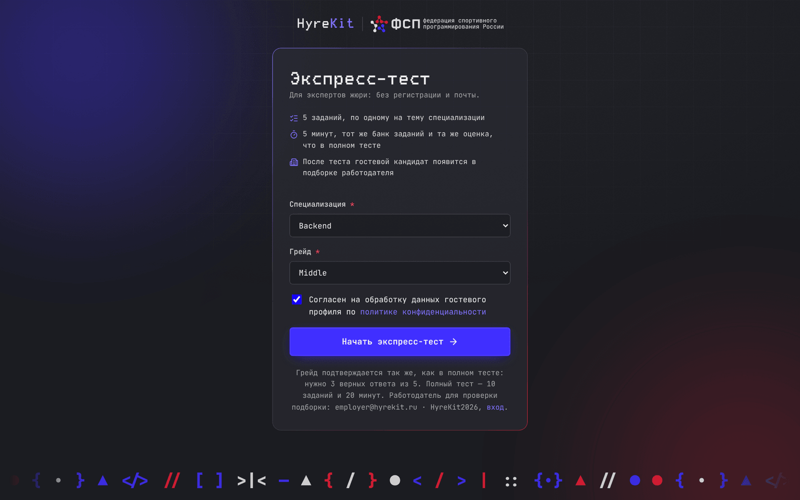
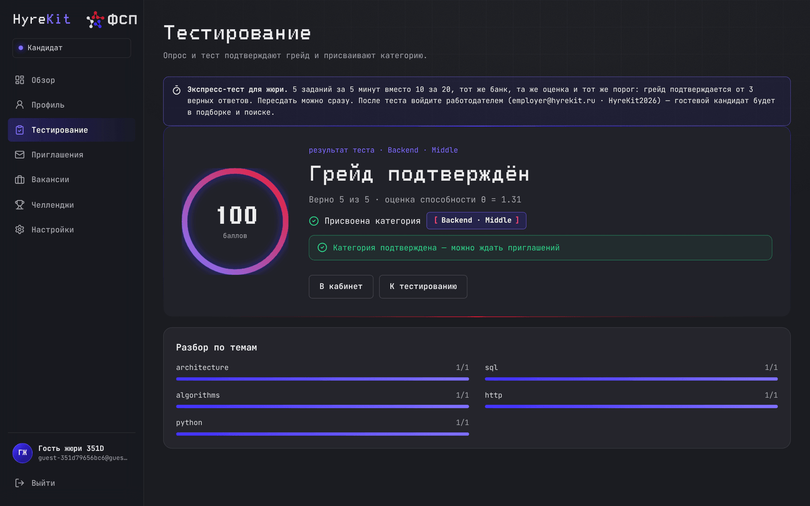
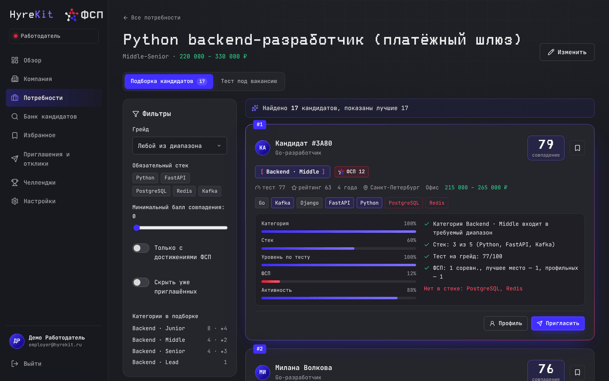

# Инструкция для жюри

Как за 10 минут проверить HyreKit самому: пройти тест кандидатом и найти себя в подборке работодателя.

## Ссылки

| Что | Адрес |
| -- | -- |
| Стенд | <https://hyrekit.ru> |
| Экспресс-тест без регистрации | <https://hyrekit.ru/express> |
| Swagger UI | <https://hyrekit.ru/docs> |
| Репозиторий | <https://github.com/Fighter90/hyrekit_fsp> |
| Презентация | [pptx](presentation/HyreKit_pitch.pptx), [pdf](presentation/HyreKit_pitch.pdf) |
| Документация | [docs/guide/](guide/README.md), одним файлом — [docx](HyreKit_Documentation.docx) и [pdf](HyreKit_Documentation.pdf) |

Если стенд недоступен, тот же прототип поднимается локально одной командой `docker compose up -d --build` и открывается на <http://localhost:3000> — подробно в [README](../README.md#инструкция-запуска).

## Демо-аккаунты

Пароль у всех — `HyreKit2026`.

| Роль | Почта | Что внутри |
| -- | -- | -- |
| Кандидат | `candidate@hyrekit.ru` | Пустой профиль — путь проходится с нуля |
| Работодатель | `employer@hyrekit.ru` | Компания «ТехноПлатформа», 3 вакансии с подборками, 2 коротких задания |
| Синтетические кандидаты | `talent01@demo.hyrekit.ru` … `talent120@demo.hyrekit.ru` | Банк из 120 кандидатов, прошедших тест через симуляцию |

На экране входа есть кнопки демо-доступа: они подставляют почту и пароль.

## Экспресс-тест за 5 минут

1. Откройте <https://hyrekit.ru/express> или нажмите на главной «Экспресс-тест за 5 минут без регистрации».
2. Выберите направление и грейд, например Backend · Middle, отметьте согласие и нажмите «Начать экспресс-тест». Почта и пароль не нужны: каждый запуск создаёт отдельного гостевого кандидата, эксперты друг другу не мешают.
3. Ответьте на 5 заданий — по одному на тему направления, по минуте на задание. Можно выбирать варианты мышью или клавишами 1–9, переходить стрелками. Обратите внимание: условия собираются из случайных данных, у соседа по столу задания будут другими.
4. Нажмите «Завершить» и посмотрите результат: оценка способности θ, балл, разбор по темам и решение. Грейд подтверждается от 3 верных ответов из 5 — тот же порог, что в полном тесте. Пересдать можно сразу.

Экспресс-тест берёт тот же банк заданий и ту же оценку, что полный тест из 10 заданий за 20 минут; на 5 заданиях оценка менее точна. Размер и время заданы в `src/app/assessment/engine.py`.

## Что посмотреть работодателем

Войдите как `employer@hyrekit.ru` (в другом браузере или окне инкогнито, чтобы не выйти из гостя).

1. **Потребности → «Python backend-разработчик (платёжный шлюз)»** — подборка по убыванию соответствия. У каждого кандидата полосы компонентов балла, причины («Категория входит в диапазон», «Стек: 3 из 5») и недостающий стек красным. Если вы прошли экспресс-тест на Backend, ваш гость тоже здесь.
2. **Фильтры** — «Только с достижениями ФСП», обязательный стек, минимальный балл. Сбросьте фильтры: исходная подборка не теряется.
3. **Вкладка «Тест под вакансию»** — темы теста выведены из стека вакансии, с причиной, и два варианта с разными заданиями и одинаковой сложностью.
4. **Банк кандидатов** — поиск по всей базе: направление, грейд, стек, наличие достижений ФСП. В карточке видны достижения с отметкой «профильное»; контакты скрыты.
5. **«Пригласить»** — описание, вилка зарплаты (обязательна), способ связи. Повторно пригласить того же кандидата, пока первое приглашение не закрыто, нельзя.

## Полный путь кандидата (по желанию, 10–15 минут)

1. Войдите как `candidate@hyrekit.ru`.
2. «Профиль» — загрузите PDF-резюме или заполните вручную.
3. «Тестирование» — опрос и полный тест: 10 заданий, 20 минут.
4. «Настройки» — согласие на публикацию и ФСП ID: `FSP-123457` (есть история) или `FSP-123450` (истории нет).
5. Работодателем пригласите этого кандидата, кандидатом примите приглашение — у работодателя откроются ФИО и контакты.

Пошаговый сценарий — [docs/guide/05-zapusk-i-demo.md](guide/05-zapusk-i-demo.md#демо-за-5-минут).

## Где проверить цифры

- Методика тестирования и подбора — [docs/guide/03-metodika-ocenki.md](guide/03-metodika-ocenki.md).
- Валидация на синтетических кандидатах — [docs/validation/results.md](validation/results.md), пересчитывается командой `PYTHONPATH=src python scripts/validate.py`.
- Нагрузка — [docs/validation/load.md](validation/load.md).
- Что в MVP не входит: ФСП ID на Keycloak, реальный реестр ФСП, модерация работодателей и ATS — [docs/guide/04-arhitektura.md](guide/04-arhitektura.md#концепция-за-рамками-mvp); Code Arena (задачи с запуском кода) — отдельный эпик, см. [ADR 0003](decisions/0003-parametricheskie-zadaniya-i-rasch.md).
