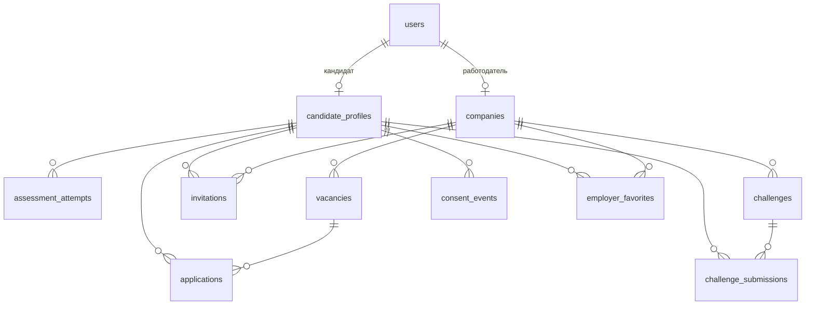

# Схема данных

PostgreSQL 16 в Docker и на площадке, SQLite при локальном запуске и в тестах. Схема создаётся миграцией `alembic/versions/0001_initial_schema.py` из моделей SQLAlchemy (`src/app/*/models.py`). Идентификаторы — UUID, время — UTC без часового пояса.

## Что где лежит

| Таблица | Содержимое |
| -- | -- |
| `users` | Учётная запись, роль `candidate` или `employer`, подтверждение почты |
| `candidate_profiles` | Анкета, стек, грейд и категория, θ и балл теста, ФСП ID и снимок достижений, настройки приватности, дата согласия |
| `assessment_attempts` | План попытки (семейства, уровни, зёрна), ответы, срок, результат и решение по грейду |
| `companies` | Профиль компании работодателя, одна на пользователя |
| `vacancies` | Потребность: специализация, диапазон грейдов, стек, вилка, публикация |
| `invitations` | Приглашение компании кандидату: предложение, вилка, способ связи, статус |
| `applications` | Отклик кандидата на вакансию и его статус |
| `challenges`, `challenge_submissions` | Короткие задания и ответы кандидатов с оценкой |
| `consent_events` | Журнал выдачи и отзыва согласия с редакцией текста |
| `employer_favorites` | Избранное компании: кандидат, при желании потребность и заметка |

Правильные ответы теста в базе не хранятся: план попытки содержит только семейство, уровень и зерно, ответ вычисляется генератором при проверке.

## Таблицы

### `users`

| Поле | Тип | Ограничения |
| -- | -- | -- |
| `email` | varchar | unique, index, not null |
| `hashed_password` | varchar | not null |
| `full_name` | varchar |  |
| `role` | varchar | not null |
| `is_active` | boolean | not null |
| `is_verified` | boolean | not null |
| `phone` | varchar |  |
| `city` | varchar |  |
| `avatar_url` | varchar |  |
| `deleted_at` | datetime |  |
| `scheduled_deletion` | datetime |  |
| `id` | uuid | PK |
| `created_at` | datetime | not null |
| `updated_at` | datetime | not null |

### `candidate_profiles`

| Поле | Тип | Ограничения |
| -- | -- | -- |
| `user_id` | uuid | FK → users.id, unique, index, not null |
| `full_name` | varchar |  |
| `city` | varchar |  |
| `phone` | varchar |  |
| `telegram` | varchar |  |
| `contact_email` | varchar |  |
| `headline` | varchar |  |
| `about` | text |  |
| `industry` | varchar |  |
| `specialization` | varchar | index |
| `declared_grade` | varchar |  |
| `experience_years` | float |  |
| `stack` | json | not null |
| `roles` | json | not null |
| `soft_skills` | json | not null |
| `salary_from` | integer |  |
| `salary_to` | integer |  |
| `work_format` | varchar |  |
| `grade` | varchar | index |
| `category` | varchar | index |
| `test_score` | float |  |
| `ability` | float |  |
| `grade_changed_at` | datetime |  |
| `last_activity_at` | datetime |  |
| `fsp_id` | varchar | index |
| `fsp_snapshot` | json |  |
| `privacy` | json | not null |
| `consent_given_at` | datetime |  |
| `resume_text` | text |  |
| `id` | uuid | PK |
| `created_at` | datetime | not null |
| `updated_at` | datetime | not null |

### `companies`

| Поле | Тип | Ограничения |
| -- | -- | -- |
| `owner_id` | uuid | FK → users.id, unique, index, not null |
| `name` | varchar | not null |
| `industry` | varchar |  |
| `description` | text |  |
| `website` | varchar |  |
| `contact_email` | varchar |  |
| `contact_phone` | varchar |  |
| `city` | varchar |  |
| `id` | uuid | PK |
| `created_at` | datetime | not null |
| `updated_at` | datetime | not null |

### `assessment_attempts`

| Поле | Тип | Ограничения |
| -- | -- | -- |
| `profile_id` | uuid | FK → candidate_profiles.id, index, not null |
| `specialization` | varchar | not null |
| `grade` | varchar | not null |
| `plan` | json | not null |
| `answers` | json | not null |
| `started_at` | datetime | not null |
| `deadline_at` | datetime | not null |
| `finished_at` | datetime |  |
| `score` | float |  |
| `ability` | float |  |
| `correct` | integer |  |
| `total` | integer |  |
| `passed` | boolean |  |
| `assigned_grade` | varchar |  |
| `suggestion` | varchar |  |
| `by_topic` | json |  |
| `id` | uuid | PK |
| `created_at` | datetime | not null |
| `updated_at` | datetime | not null |

### `challenges`

| Поле | Тип | Ограничения |
| -- | -- | -- |
| `company_id` | uuid | FK → companies.id, index, not null |
| `title` | varchar | not null |
| `description` | text | not null |
| `specialization` | varchar | index, not null |
| `due_at` | datetime |  |
| `id` | uuid | PK |
| `created_at` | datetime | not null |
| `updated_at` | datetime | not null |

### `vacancies`

| Поле | Тип | Ограничения |
| -- | -- | -- |
| `company_id` | uuid | FK → companies.id, index, not null |
| `title` | varchar | not null |
| `description` | text | not null |
| `team_description` | text |  |
| `specialization` | varchar | index, not null |
| `grade_min` | varchar | not null |
| `grade_max` | varchar | not null |
| `stack` | json | not null |
| `salary_from` | integer | not null |
| `salary_to` | integer | not null |
| `work_format` | varchar | not null |
| `city` | varchar |  |
| `is_published` | boolean | index, not null |
| `id` | uuid | PK |
| `created_at` | datetime | not null |
| `updated_at` | datetime | not null |

### `applications`

| Поле | Тип | Ограничения |
| -- | -- | -- |
| `vacancy_id` | uuid | FK → vacancies.id, index, not null |
| `profile_id` | uuid | FK → candidate_profiles.id, index, not null |
| `message` | text |  |
| `status` | varchar | index, not null |
| `id` | uuid | PK |
| `created_at` | datetime | not null |
| `updated_at` | datetime | not null |

### `challenge_submissions`

| Поле | Тип | Ограничения |
| -- | -- | -- |
| `challenge_id` | uuid | FK → challenges.id, index, not null |
| `profile_id` | uuid | FK → candidate_profiles.id, index, not null |
| `answer` | text | not null |
| `score` | float |  |
| `feedback` | text |  |
| `id` | uuid | PK |
| `created_at` | datetime | not null |
| `updated_at` | datetime | not null |

### `invitations`

| Поле | Тип | Ограничения |
| -- | -- | -- |
| `company_id` | uuid | FK → companies.id, index, not null |
| `profile_id` | uuid | FK → candidate_profiles.id, index, not null |
| `vacancy_id` | uuid | FK → vacancies.id |
| `title` | varchar | not null |
| `message` | text | not null |
| `salary_from` | integer | not null |
| `salary_to` | integer | not null |
| `contact` | varchar | not null |
| `status` | varchar | index, not null |
| `decline_reason` | text |  |
| `id` | uuid | PK |
| `created_at` | datetime | not null |
| `updated_at` | datetime | not null |

### `consent_events`

| Поле | Тип | Ограничения |
| -- | -- | -- |
| `profile_id` | uuid | FK → candidate_profiles.id, index, not null |
| `kind` | varchar | not null |
| `version` | varchar | not null |
| `action` | varchar | not null |
| `id` | uuid | PK |
| `created_at` | datetime | not null |
| `updated_at` | datetime | not null |

### `employer_favorites`

| Поле | Тип | Ограничения |
| -- | -- | -- |
| `company_id` | uuid | FK → companies.id, index, not null |
| `profile_id` | uuid | FK → candidate_profiles.id, index, not null |
| `vacancy_id` | uuid | FK → vacancies.id |
| `note` | varchar |  |
| `id` | uuid | PK |
| `created_at` | datetime | not null |
| `updated_at` | datetime | not null |

Уникальность: одна запись на пару `company_id` + `profile_id`.
